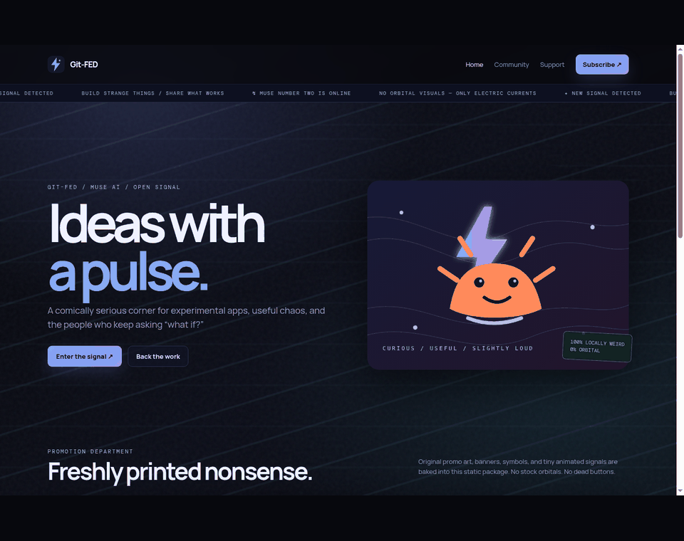
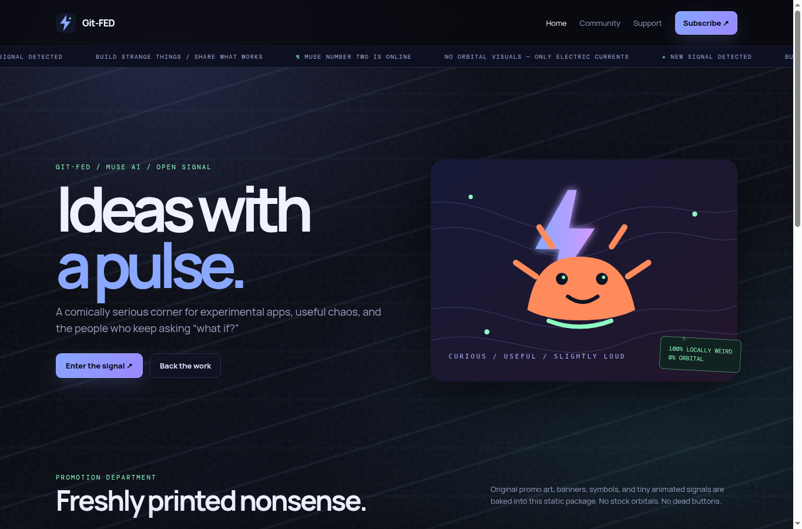
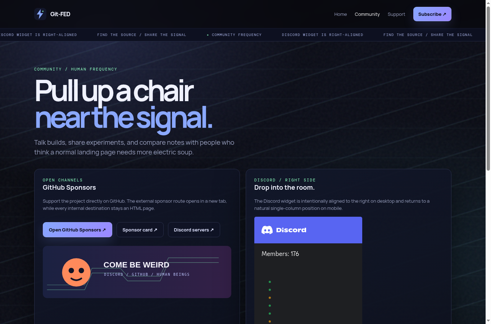
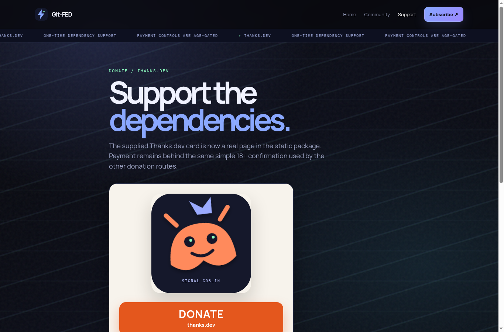
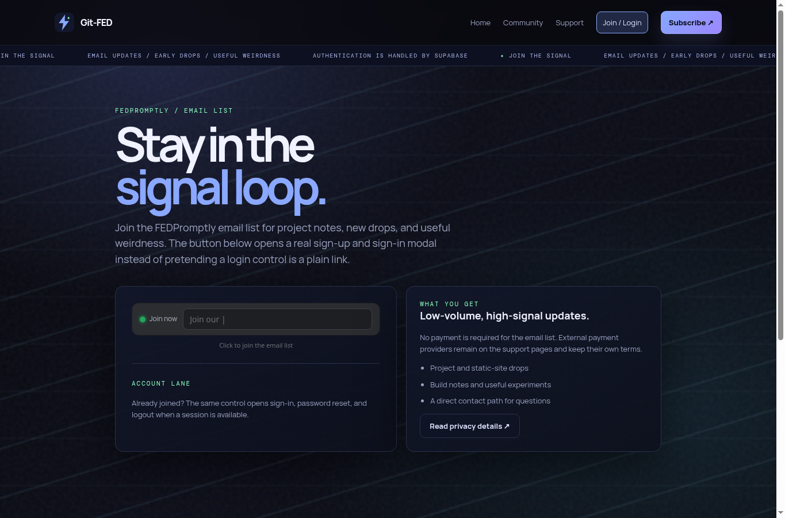

# Meta AI Desktop + Git-FED Static Site

A local Electron launcher for a remote Meta AI Android build, paired with a dark, animated Git-FED promotional site that can be deployed as plain static HTML.

[](LICENSE)

> **Two deliverables, one repository:** the root project is the desktop wrapper; [`site/`](site/) is an independent GitHub Pages / Cloudflare Pages package.

## Why this exists

Testing an Android build from a desktop usually means juggling a browser tab, a long Appetize URL, and scattered notes about what is actually running remotely. This project turns that into a focused desktop doorway: launch the local Electron shell, then open the Appetize session only when you need it.

The second half of the repository solves a different problem. Promotional sites often end up as a pile of dead buttons, stock orbitals, and unclear payment routes. The Git-FED site keeps every internal destination as a real HTML page, uses a dark non-orbital current-field visual system, includes original local artwork, and puts payment or private-community routes behind explicit gates.

It is intentionally small and inspectable. There is no Manus-hosted website, no proprietary backend, and no claim that the Electron shell runs the APK locally. Appetize provides the streamed Android session; Electron provides the local window and controlled launcher UI.

## See it work

**Live demo:** none is currently published. The repository contains deployable static files, but `site/robots.txt` and `site/sitemap.xml` still use `https://example.com` until you replace it with your real domain.

**Fastest local static preview:**

```bash
cd site
python3 -m http.server 8765
# open http://127.0.0.1:8765/
```

The preview tour below is captured from the real local `site/` pages, not a product mockup. It cycles through the landing page, community page, and Thanks.dev donation page.



**Fastest desktop demo:**

```bash
npm install
npm start
```

Click **Launch Meta AI** in the local Electron window. The launcher opens the configured Appetize Play URL in a separate window. Internet access and an available Appetize session are required.

## Screenshots

The screenshots below were rendered from the repository's actual static site with Chromium after restoring the shared stylesheet. They show the main workflow, a meaningful community layout, and the payment age-gate route.

| Landing page | Community page |
|---|---|
|  |  |





## Quick start

### Windows icon and packaging set

The Electron app now includes a symbol-only Windows icon package: `assets/app-icon.ico` contains 16, 24, 32, 48, 64, 128, and 256 pixel layers. Matching PNG sizes, SVG artwork, favicon ICO/PNG fallbacks, and the Windows installer configuration are included. The browser shell, Electron windows, app user model ID, and electron-builder all point at the same icon family.

### Electron launcher

```bash
# install dependencies
npm install

# run the desktop launcher
npm start

# create a Windows installer / portable build
npm run build
```

For GitHub-hosted Windows builds, see [`docs/GITHUB-BUILD.md`](docs/GITHUB-BUILD.md). The workflow uploads the NSIS installer and portable executable as downloadable Actions artifacts; version tags also create GitHub releases.

The Electron entry point is [`main.js`](main.js). The local shell is [`index.html`](index.html), its secure bridge is [`preload.js`](preload.js), and the animated launcher behavior is in [`renderer.js`](renderer.js). Windows packaging is defined in [`electron-builder.yml`](electron-builder.yml), and GitHub Actions builds the installer on `windows-latest`. The Play URL is configured in both `main.js` and `renderer.js`:

```text
https://appetize.io/app/b_vmsfd6j2qw2ffdla37n7taxgdq
```

### Static site

The static package has no build step. The `Join / Login` header action opens a Supabase Auth-backed email-list page; use a deployed HTTP(S) origin or the local Python server so the external client can load:

```bash
cd site
python3 -m http.server 8765
# browse to http://127.0.0.1:8765/index.html
```

Useful pages to open immediately:

- [`site/index.html`](site/index.html) — animated landing page and visual asset showcase
- [`site/community.html`](site/community.html) — community, GitHub Sponsors, and Discord panel
- [`site/support.html`](site/support.html) — subscription, donation, sponsor, and newsletter lanes
- [`site/thanks.html`](site/thanks.html) — Thanks.dev donation page with an 18+ gate
- [`site/login.html`](site/login.html) — Join / Login email-list modal backed by Supabase Auth
- [`site/private-communities.html`](site/private-communities.html) — 18+ and country eligibility gate before the private Matrix route

### Test / validation

There is no automated test suite or CI workflow in this repository yet. The current lightweight validation is syntax checking plus the static-site link and asset checks documented in [`site/DEPLOYMENT.md`](site/DEPLOYMENT.md):

```bash
node --check main.js
node --check preload.js
node --check renderer.js
node --check site/js/site.js
```

## Visual asset gallery

All promotional artwork is local to the repository. The visual language is intentionally dark, playful, electric, and non-orbital.

### Core brand and motion

| Asset | Preview |
|---|---|
| `site/assets/logo-symbol.svg` |  |
| `site/assets/favicon.svg` |  |
| `site/assets/signal-loop.gif` |  |
| `assets/app-icon.svg` |  |

### Promotional illustrations

| Asset | Preview |
|---|---|
| `site/assets/hero-banner.svg` |  |
| `site/assets/promo-muse.svg` |  |
| `site/assets/promo-gitfed.svg` |  |
| `site/assets/mascot-sticker.svg` |  |
| `site/assets/community-banner.svg` |  |
| `site/assets/donation-banner.svg` |  |

### Documentation and deployment

- [`site/DEPLOYMENT.md`](site/DEPLOYMENT.md) — GitHub Pages and Cloudflare Pages setup
- [`docs/CHAT-DETAILS.md`](docs/CHAT-DETAILS.md) — build and Appetize details preserved from the supplied project notes
- [`docs/APPETIZE-FREE-LIMITS.md`](docs/APPETIZE-FREE-LIMITS.md) — what the Appetize minutes affect
- [`docs/OWN-CLONE-RESEARCH.md`](docs/OWN-CLONE-RESEARCH.md) — why a true Appetize-style clone is a separate infrastructure product
- [`docs/GITHUB-BUILD.md`](docs/GITHUB-BUILD.md) — GitHub Actions, Windows artifacts, tagging, and Pages deployment
- [`FILE-INVENTORY.md`](FILE-INVENTORY.md) — package contents

## Deployment

The `site/` directory is designed for static hosting:

- **GitHub Pages:** publish the contents of `site/` and keep its HTML, `css/`, `js/`, and `assets/` paths together.
- **Cloudflare Pages:** use an empty build command and `site` as the output directory. The included `_headers` and `_redirects` files provide the static routing helpers.
- **Cloudflare Worker:** serve `site/` as static assets if you choose a Worker instead of Pages. This repository does not create or configure that Worker for you.

Before publishing, replace the example domain in [`site/robots.txt`](site/robots.txt) and [`site/sitemap.xml`](site/sitemap.xml). Payment provider accounts, pricing, tax, age/consent compliance, and refund policy remain the operator's responsibility.

## Important limitations

- The Electron project is a desktop shell around Appetize; it does not run the APK locally.
- Appetize streaming requires internet access and consumes the Appetize session allowance described in the docs.
- Emulator-restricted capabilities such as Bluetooth pairing, camera access, NFC, and Meta AI glasses pairing may not work through this remote session.
- The static site has no backend. Its age gates are front-end confirmation flows, not identity verification.
- No live demo URL or GitHub repository URL is claimed because none is configured in this package. GitHub Actions build and Pages workflow files are included, but they run only after the repository is pushed to GitHub and Actions/Pages are enabled.
- The private Matrix URL is intentionally not in the public footer; it is revealed only after the separate 18+ and eligible-country gate.
- The Join / Login page requires a deployed HTTP(S) origin and a loaded Supabase client; the static preview still renders the widget if the external auth script is unavailable.

## License

The project is licensed under the [MIT License](LICENSE).
